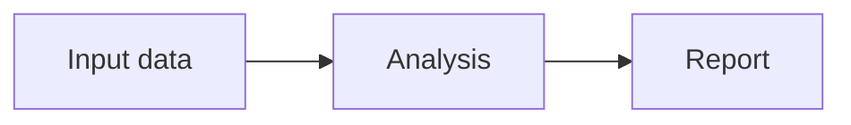

# Diagrams and visual review

CLIO renders Mermaid diagram source with bundled Pele, with the existing Mermaid
renderer retained for compatible documents Pele cannot render. No external
rendering service or CDN is required. Flowcharts, sequences, git graphs, mindmaps
and railroad grammars are useful alternatives for different relationships.
Quantitative charts retain their existing data, filtering and selection semantics.

Agents can discover `create-diagram`, use a small Mermaid block in chat, or use
the active catalog's `clio.mermaid.v1` with inline source or a registered source
artifact. Saved dashboards use the same renderer. Authored HTML/SVG is another
available form when a custom illustration or interaction is useful.

## Fit the content

Full-width, equal-column, uneven-column and vertical compositions are options.
Choose space according to labels, relationships and the viewing width. The viewer
fits the diagram to its canvas, derives its height from the rendered content,
adapts to the active theme, and retains zoom, full screen and SVG/PNG/source exports.

For substantial visual work, `review-visual-presentation` describes the loop:
publish, inspect the matching viewer, capture an image, identify concrete defects,
revise, and inspect a fresh capture. A successful schema check or source review
does not establish that the resulting view is readable. Docked and expanded views
can require different compositions.

## Open workflow folders

Declare the node and its directory explicitly, after checking the real workspace:

The client consumes these declarations as navigation into that workspace's Files
tab and strips them before rendering. Keyboard users can reach the same folder
actions. Exports retain the diagram; workspace navigation requires an open CLIO
workspace. Source downloads preserve the declarations.

Targets are relative directory paths, with reserved filename characters percent
encoded. Parent traversal, absolute paths, arbitrary URLs and executable callbacks
are rejected. Opening a folder does not run a command or add an access grant;
the existing workspace file policy remains authoritative. The viewer does not
guess paths from a stage's visible label.
